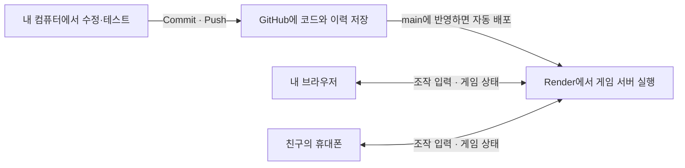

# 우리 게임으로 배우는 실제 게임 개발

실제 게임 개발자들도 언어로 게임 규칙을 만들고, 원본과 변경 이력을 저장하고, 배포한 서버를 운영한다. 이 저장소를 직접 열어보면서 같은 과정을 배울 수 있다.

## 엔진과 언어

게임을 만드는 도구인 엔진과 그 안에서 사용하는 언어를 구분하자.

| 만드는 방식 | 사용하는 언어 | 역할 |
| --- | --- | --- |
| [Unity](https://unity.com/how-to/programming-unity) | C# | 이동, 전투, 아이템, UI 등의 동작 구현 |
| [Unreal Engine](https://dev.epicgames.com/documentation/unreal-engine/coding-in-unreal-engine-blueprint-vs-cplusplus) | C++와 Blueprint | 코드와 시각적인 노드 연결을 조합해 제작 |
| [Godot](https://docs.godotengine.org/en/stable/tutorials/scripting/index.html) | GDScript, C# 등 | 2D·3D 게임의 규칙과 동작 구현 |
| Human Enough! | JavaScript | Three.js로 3D 화면을 그리고 Node.js로 서버 실행 |

Node.js는 별도의 언어가 아니다. JavaScript를 서버 컴퓨터에서 실행하는 환경이다. 우리 게임은 화면과 서버 양쪽에 JavaScript를 사용한다. 먼저 기존 게임의 JavaScript를 읽고 작은 변화를 적용하면서 코드와 결과를 연결해보면 좋다.

## 무엇을 어디에 저장하는가

| 종류 | 예 | 보관 방법 |
| --- | --- | --- |
| 게임 코드 | JS, MJS, HTML, CSS | Git으로 변경 이력을 저장하고 GitHub에 업로드 |
| 제작 원본 | Blender BLEND, 편집 원본 | 원본 보관과 별도 백업; 큰 파일은 Git LFS 등 사용 |
| 게임용 파일 | GLB 모델, PNG 이미지, 소리 | 게임과 함께 배포하거나 파일 저장소에서 제공 |
| 플레이어 기록 | 계정, 아이템, 영구 랭킹 | 데이터베이스에 저장 |

캐릭터 제작은 **Blender 원본 `.blend` → 게임용 `.glb` 내보내기 → 게임에서 불러오기** 순서로 이어진다. 수정할 원본과 실행용 결과물을 둘 다 보관해야 한다. 이번 전체 백업에는 둘 다 포함되어 있다.

[Git LFS](https://docs.github.com/en/repositories/working-with-files/managing-large-files/about-git-large-file-storage)는 저장소에 작은 참조 정보를 두고 실제 큰 파일을 별도로 저장한다. 이 저장소에서는 기존 게임 실행용 파일을 유지하면서 추가 제작 원본과 영상 등에 LFS를 적용했다.

팀에서는 같은 아트 파일을 동시에 수정하지 못하게 잠그기도 한다. [Unreal의 소스 관리](https://dev.epicgames.com/documentation/en-us/unreal-engine/source-control-in-unreal-engine)는 Perforce 등의 연결과 파일 잠금을 지원한다.

## Save, Commit, Push, 배포

1. **Save:** 수정한 파일을 내 컴퓨터에 저장한다.
2. **Commit:** “포션 회복량 조정” 같은 설명과 함께 변경 이력을 저장한다.
3. **Push:** 이력을 GitHub에 업로드한다.
4. **테스트·검토·배포:** 검증한 변경을 안정된 버전에 합치고 서버에 반영한다.

연습은 별도 브랜치에서 진행한다. 기본 버전을 유지하면서 새 기능을 실험할 수 있다. [GitHub flow](https://docs.github.com/en/get-started/using-github/github-flow)는 브랜치, 변경, Commit과 Push, 검토, 병합으로 이어진다.

GitHub는 소스와 이력을 보관하고 Render는 그 소스를 실행한다. 이 프로젝트에서는 main의 새 커밋이 자동 배포되며, 이번 보관용 커밋처럼 `[skip render]`가 들어간 커밋은 재배포를 건너뛴다.

## 멀티플레이 서버의 역할

우리 게임에서 F를 누르면:

1. 브라우저가 서버에 유혹 버튼을 눌렀다고 보낸다.
2. 서버가 거리, 능력 게이지와 현재 행동 상태를 검사한다.
3. 조건이 맞으면 게이지를 줄이고 인간이 따라오는 시간을 설정한다.
4. 결과를 모든 플레이어에게 보낸다.
5. 각 기기가 그 결과에 맞춰 캐릭터와 효과를 그린다.

중요한 판정을 서버가 맡는 것이 서버 권위 방식이다. 플레이어의 컴퓨터가 게이지나 판정 결과를 임의로 결정하지 않도록 한다.

현재 [server.mjs](server.mjs)는 초당 20번 상태를 계산하고 초당 10번 전달하도록 설정되어 있다. 각 기기는 그 사이의 움직임을 부드럽게 그린다. 통신에는 연결을 유지하며 양방향으로 메시지를 전달하는 [WebSocket](https://render.com/docs/websocket)을 사용한다.

현재 방과 진행 상황은 서버 메모리에 있다. 서버가 다시 시작하면 방도 초기화된다. 계정, 수집품, 영구 랭킹을 추가하려면 별도의 데이터베이스 저장 기능이 필요하다.

## 서버 운영

- 접속과 오류: 게임이 열리는지, 오류 로그가 있는지 확인한다.
- 업데이트: 테스트한 버전을 배포하고 문제가 생기면 이전 버전으로 복구한다.
- 성능과 비용: 동시 접속자, 메모리와 데이터 전송량을 확인한다.
- 데이터: 영구 기록을 백업하고 복구 가능 여부를 확인한다.

현재 무료 Render 서버는 15분간 들어오는 트래픽이 없으면 잠들고 다음 접속에 다시 시작한다. [무료 서버 안내](https://render.com/docs/free)의 지연과 사용량 제한을 이해하고 운영 규모에 맞춰 구성을 선택해야 한다. 실제 설정은 [DEPLOYMENT.md](DEPLOYMENT.md)에 기록했다.

## 직접 읽어볼 파일과 첫 연습

| 배우고 싶은 것 | 파일 |
| --- | --- |
| 캐릭터 이름·성격·대사, 맵 | [shared/world.mjs](shared/world.mjs) |
| 둔갑 주기와 유혹 시간 | [shared/disguise.mjs](shared/disguise.mjs) |
| 포션·유혹·승패 판정 | [shared/simulation.mjs](shared/simulation.mjs) |
| 3D 화면·카메라·버튼 | [public/game.js](public/game.js) |
| 방 생성·접속·통신 | [server.mjs](server.mjs) |

첫 연습은 연습용 브랜치에서 캐릭터 대사를 하나 바꾸고 내 컴퓨터에서 확인한 다음 Commit과 Push까지 직접 해보는 것이다. 다음으로 둔갑 주기나 포션 회복량을 바꿔볼 수 있다. 규칙을 바꾸면 화면 설명과 테스트도 함께 맞춘다.

전체 원본을 내려받고 검증하는 방법은 [SOURCE_BACKUP.md](SOURCE_BACKUP.md)를 따른다.
