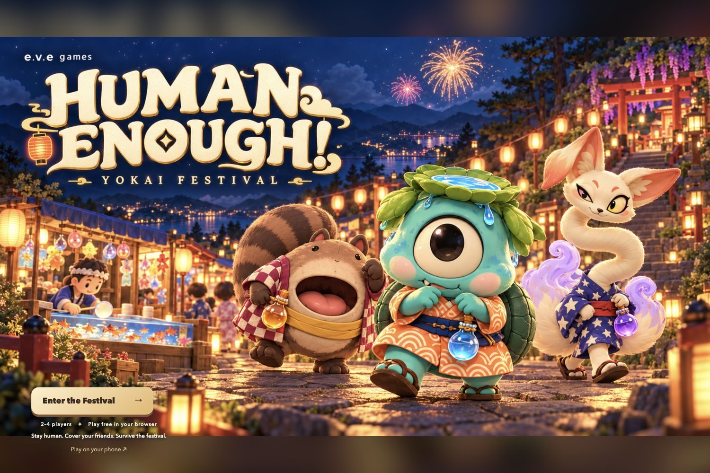

# Human Enough! — Yokai Festival

**A cooperative browser game by Junsu (Michael) Kim / E.V.E Games.**

[Read the project case study](https://playlist0726-code.github.io/projects/human-enough/) · [Play online](https://human-enough-yokai-festival.onrender.com/) · [Portfolio](https://playlist0726-code.github.io/)



## Portfolio overview

- **Goal:** make cooperation visible through disguise cover, potion sharing, guest handoffs, and a shared escort objective.
- **Contribution:** game concept, interaction design, visual direction, and AI-assisted implementation.
- **Implementation:** Three.js browser client, Node.js WebSocket server, shared deterministic game rules, reconnect/session handling, six first-person stall games, and a cooperative boss encounter.
- **Status:** playable competition submission, with solo practice. Submission is not an award claim. AI assisted development and asset workflows; the game does not require a live language model.
- **Review note:** the free hosted server may need 50 seconds or more to wake. Source and local setup are available below if the demo is asleep.

The project made onboarding, readable feedback, and connection recovery part of the design work alongside the world and characters. The case study explains the decisions and remaining questions; the reference below covers operation and implementation.

---

# Human Enough! · e.v.e games

A cozy 3D browser co-op game about yokai sneaking into a mountaintop fireworks festival. All player-facing text is in English.

## Run locally

Requires Node.js 22 or later.

```sh
npm install
npm run dev
```

Open http://127.0.0.1:4173/. Select **Enter the Festival** on the illustrated title screen. Choose one of seven yokai, then select **Solo practice** or **Create room**. Friends can join using the 5-character room code and select **Ready up**. The host starts a synchronized 3-second countdown once everyone is ready. A crew of 3–4 is recommended; smaller groups can start for testing.

Public game: https://human-enough-yokai-festival.onrender.com/ — both the game and WebSocket server are hosted on Render. The local address below is for development. The free hosted instance may take 50 seconds or more to wake after inactivity.

## Controls

| Action | Control |
|---|---|
| Move | WASD / arrows / ground click / touch joystick |
| Jump | Space / Jump button |
| Share one potion with the nearest teammate (within 3 steps) | R / Share |
| Hand one following guest to the nearest teammate | T / Hand off |
| Menu, settings, journal and leave | Esc / ☰ |
| Call for help / mark your position for the crew | G / Help ping |
| Interact with a stall, bottle, or human | E / Interact button |
| Drink a potion | Q / Potion button |
| Charm a nearby human | F / Charm button |
| Hide nearby teammates’ yokai features | C / Cover button |
| Zoom | Mouse wheel |
| Rotate view | Right-drag / Rotate button |
| Close/wide view and graphics quality | View and Quality buttons |

Movement follows the camera orientation. Ground clicks use the actual sloped terrain but do not automatically find a route around obstacles. The server enforces collisions, potion use, jumping, charms, and rewards. One player must escort three humans to the summit shrine for the whole team to win.

## Six first-person stall games

Approach the front of a stall until **E · Play** appears, then press E. The game automatically uses your selected yokai’s hands, sleeves, tools, and the matching booth. Play with mouse, touch, or the on-screen keyboard instructions. **Back to festival** or **Escape** returns to the world.

| Booth | First-person interaction | Win condition | Reward |
|---|---|---|---|
| Cork Shooting | Drag to aim, then Fire | 3 prizes in 6 shots | 1 potion |
| Goldfish Scooping | Drag the net, then release/lift | Catch 3 fish before 6 torn nets | Disguise ward: 15s |
| Ring Toss | Hold/release or pull upward; aim at center | Land 3 of 5 rings at golden power | +35% speed for 20s |
| Takoyaki | Tap a golden ball / aim and Flip / keys 1–6 | Cook 4 of 6 | +35 spirit |
| Lucky Draw | Pull one bag upward / keys 1–3 | Reveal one bag | Potion, +45 spirit, or a 20s disguise ward |
| Shaved Ice | Circle the crank / Turn handle / Space, then select syrup | 12 turns and the ordered syrup | +20 spirit and an 8s disguise ward |

Three potions is the carrying limit; an extra potion prize becomes +25 spirit. Each successful booth adds one unique festival stamp. Revisit cooldowns are 45s after success, 8s after failure, and 5s after cancellation. You have 20s to begin and 15–18s to play. Results return automatically after 20s if left open.

Your friends and the festival timer continue while you play. Your movement and abilities pause. Your spirit drain pauses during the introduction and active game, and your own nearby followers are protected. That temporary protection ends on the result screen.

## Integration details

The provided `eve_festival_minigames_fps_v02.zip` was adapted into `public/minigames/`. Its six booth scenes, separate first-person cameras, tools, and interactions are retained. The embedded view locks the character and game to the current server session. It uses the same installed Three.js and shared model modules as the world; a duplicate vendor engine is not shipped.

- `public/stall-ui.mjs`: same-origin iframe host; mounts when a booth session opens, forwards normalized actions, and restores world focus on close.
- `public/minigames/app.mjs`: first-person UI and visual feedback. Embedded play renders server snapshots and never grants rewards locally.
- `public/minigames/first-person.mjs`: six camera/tool setups and seven yokai hand styles.
- `shared/minigames.mjs`: shared deterministic rules, including the new ring power/aim input.
- `shared/stall-protocol.mjs`: origin/window/channel checks and a whitelist of permitted input fields.
- `shared/simulation.mjs`: session validation, movement lock, cooldowns, reward settlement, and stamp ownership.
- `server.mjs`: WebSocket state updates and per-input acknowledgements, correlated to the live session.

The host sends the session, kind, character, seed, server time, state, and stamps after the frame is ready. The frame sends inputs with request IDs. The server validates the session and actual rules, settles each reward once, and returns an acknowledgement. Old-frame messages cannot operate a new booth session. Client-reported scores or prize objects are discarded by the host.

The world renderer pauses while the booth is visible. Removing the frame ends its loop and releases its WebGL context. No external font requests are needed. The original ZIP contents and a pre-integration backup are preserved under `integrations/`.

## Graphics and assets

The festival uses fully volumetric yokai and human models, patterned outfits, material detail, a sloped stone path, stalls, lanterns, foliage, water, fireworks, shadows, bloom, and optional ambient occlusion. View and Quality controls support lower-powered devices. These procedural models are still distinct from final artist-made assets matching the concept sheets.

Original character art and festival images supplied by the creator remain in `public/assets/`. The six first-person games use 3D booth geometry rather than the old illustrated minigame panels. Research from the previous graphics pass remains in `GRAPHICS_RESEARCH.md`.

## Verification

Tests cover rules, input validation, ring power/aim, session replay rejection, unique rewards, movement restoration, English UI sources, model animation, paths, and multiplayer state. Real-device performance and public-network behavior still need deployment testing.


## Round flow and recovery

- Guests ready up in the lobby; the host starts a shared three-second countdown. Disconnects or departures cancel a countdown. A running round cannot be restarted by another start request.
- A temporary disconnect reserves the character and session for 30 seconds. The same browser tab automatically reconnects, including after refresh. The festival clock keeps running. An active booth closes on disconnect, preventing stale iframe input from awarding anything. Explicit **Leave festival** releases the spot immediately.
- The host role moves to a connected teammate on disconnect. A returning former host keeps their character, inventory, deliveries and position, but does not take host authority back.
- **Esc / ☰** opens the menu. Solo play pauses the festival simulation; an online crew continues playing. Help and the menu stop local movement. Leaving requires a confirmation.
- Settings (sound effects, graphics, camera), chosen character and name are saved on this device. Completed nights, wins, collected stamp types and fastest team victory are saved locally. Results are counted only once if the page is refreshed.
- The stall journal shows each reward, collected stamps and cooldowns. Choose a stall to follow a path around obstacles to its entrance. Manual movement cancels the route.
- Contextual guidance shows the next escort step, distance to the summit or nearest potion, fading charms, low spirit and the final minute/10 seconds.
- **R** shares one potion without exceeding the three-bottle bag limit. **T** transfers one nearby following guest; that guest's eventual delivery belongs to the new escort. Use this to help one teammate reach three deliveries.
- Results show every player's deliveries, prizes and potion assists. The host selects **Back to crew · Play again** to return everyone to the lobby, where readiness is checked for the next round.

## Verification

```sh
npm run check
npm test
npm run test:integration
node scripts/verify-multiplayer.mjs
node scripts/verify-actions.mjs
node scripts/verify-stalls.mjs
```

The integration test starts a temporary local server and checks real WebSocket readiness, countdown, restart protection, host migration, token recovery, duplicate-session rejection and expiration. The verification scripts use the running game on port 4173, move real players, complete all six stalls and verify rewards and cooldowns. Local network access is needed for these checks.


## Crew tools and first-night guidance

The in-game menu includes a first-night checklist based on successful actions, actual walking distance, potion collection, spell use, a stall prize and an escort delivery. It is optional and resets each night.

Open **Your crew** to see spirit, potion inventory, deliveries, distance and connection status. Choose a teammate to direct **R** potion sharing and **T** guest handoffs; invalid or distant targets are refused instead of silently switching to another player. The default remains the nearest eligible teammate.

**G / Help ping** broadcasts a fixed world location and a gold map ring for eight seconds. It has an eight-second cooldown. When everyone disconnects, the first returning crew member becomes host if no connected host remains. A host who is still connected retains authority.

The menu updates solo pause behavior if a crew shrinks to one player. World and minigame sound and graphics settings now stay in sync. Booth loading has a timed fallback message and an always-available exit. Character and visitor models are reused across room changes, and each old name-label texture is released before replacement. The server discards stale outgoing snapshots for slow sockets instead of building an unbounded queue; movement freshness is tracked separately from other messages.

### October 22–23 visual pass

The festival now has volumetric broadleaf trees, painted grass, rounded 3D paving, detailed paper lanterns and booth decoration, revised character lighting and a clearer camera/HUD. Implementation notes and validation: [GRAPHICS_V09.md](GRAPHICS_V09.md).

### Character movement

All seven yokai now have individual gaits, weight shifts, foot contact, secondary motion and blended action poses. Visitors and shop keepers also use the updated rig. Open `/motion-study.html` to compare the seven live characters. Details and verification: [CHARACTER_MOTION.md](CHARACTER_MOTION.md).

### Human disguises and short charms

Before each festival, the crew transforms from their selected yokai into distinct human disguises in a shared 4.2-second entrance scene. The festival clock starts afterwards. Every 15 seconds, a character-specific feature shows for 5 seconds. C hides nearby teammates within 3.2 steps for 5 seconds; it does not hide yourself. Ward prizes also hide features. F makes a guest follow for exactly 5 seconds; afterwards the guest waits at their stopping point until charmed again. Cover, wards, booths and handoffs do not refresh this timer. The festival HUD and minigame hands use the new rules. See [DISGUISE_RULES.md](DISGUISE_RULES.md).

## Phone testing and refined character models

Open `/phone-lab.html` for same-Wi-Fi QR invitations, optional room codes, a responsive phone preview, device diagnostics and local JSON test reports. Start the server with `npm run dev:lan` for phone access. See [PHONE_PLAYTEST.md](PHONE_PLAYTEST.md).

The current production GLBs use v03 weighted yukata/sleeves, plus chained deformation for Kon's neck and Nemu's tail. Editable Blender sources, game exports and actual roster renders are saved under `art/characters/roster-v03/`; v02 sources remain preserved.

## Demon King invasion

The festival now has cooperative boss invasions inspired by the trailer: dodge warning zones, jump shockwaves, C Ward your crew, E unbind cursed seals, and hold J / Spirit bolt while the crystal is exposed. Select **Boss practice** to try the encounter quickly. Hearts, rescues, combo shots and escort rewards share authoritative server state. See [DEMON_KING.md](DEMON_KING.md).
